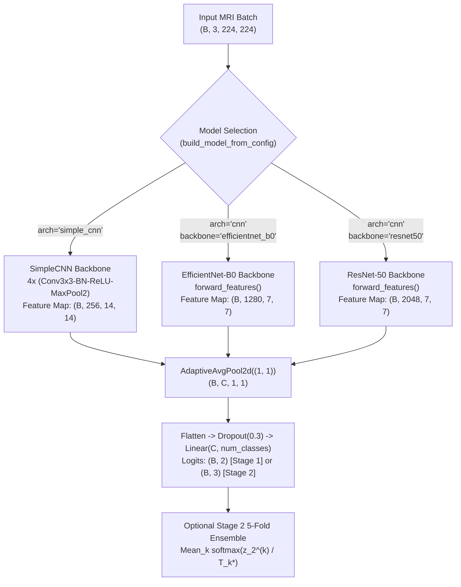

# Milestone 2: Model Architectures, Two-Phase Training & Clinical Calibration

## 1. Overview: Two-Stage Clinical Cascade Design

In Milestone 1, we eliminated patient-level data leakage (`StratifiedGroupKFold(groups=PID)`), removed cross-dataset duplicates via 64-bit DCT perceptual hashing (`pHash` + `BKTree`), and standardized cranial field-of-view and intensity ranges. Milestone 2 builds the modeling, optimization, and post-hoc calibration stack across our two-stage diagnostic cascade:

- **Stage 1 — Binary Tumor Screening (`configs/stage1.yaml`)**: Classifies `no_tumor` vs. `tumor` using a `TimmClassifier` (`efficientnet_b0`, `num_classes=2`), calibrated to achieve **Sensitivity $\ge 0.98$** so potential lesions are not missed.
- **Stage 2 — Three-Class Subtype Classification (`configs/stage2.yaml`)**: Classifies `glioma`, `meningioma`, and `pituitary` tumors using `TimmClassifier` (`efficientnet_b0`, `num_classes=3` primary; `resnet50` capacity comparison; `SimpleCNN` from-scratch baseline; plus optional 5-fold patient-grouped CV ensemble in `configs/cascade.yaml`), followed by **Temperature Scaling** and **Confidence Abstention** (`uncertainty_threshold = 0.70`).

All models are instantiated via `mri_tumor.models.build_model_from_config` (wrapping `SimpleCNN` and `TimmClassifier` in `src/mri_tumor/models/cnn.py`) and trained with `mri_tumor.training.Trainer`.

---

## 2. Transfer Learning & Two-Phase Fine-Tuning

### 2.1 Why ImageNet Pretrained Filters Transfer to 2D Brain MRI

Although ImageNet consists of natural RGB photographs rather than clinical MRI scans, convolutional backbones such as `efficientnet_b0` and `resnet50` transfer strongly to 2D MRI slices when grayscale intensities are replicated across 3 channels `(B, 3, 224, 224)`:

1. **Early Convolutional Blocks (Edges & Gabor Filters)**: First- and second-stage kernels learn universal oriented edge detectors, ridge filters, and multi-scale contrast gradients. In brain MRI, these same filters respond cleanly to skull-cortex boundaries, ventricular margins, sulcal folds, and tumor enhancement rims.
2. **Mid-Level Blocks (Textures & Geometric Junctions)**: Intermediate depthwise-separable convolutions (EfficientNet) and residual bottlenecks (ResNet) capture curvature, ring-like closed contours, and heterogeneous internal textures—directly relevant to distinguishing homogeneous meningiomas from necrotic-core glioblastomas or sellar pituitary adenomas.
3. **Domain-Specific Adaptation**: Only the global pooling and linear classification head (`AdaptiveAvgPool2d((1, 1)) -> Flatten -> Dropout(0.3) -> Linear`) are task-specific and randomly initialized.

### 2.2 The "Gradient Shock" Problem at Epoch 0

If a pretrained backbone is unfrozen immediately at Epoch 0 alongside a randomly initialized head:
- The random head outputs poorly calibrated logits with large cross-entropy loss.
- Large, noisy error gradients $\nabla_{\theta_{\text{backbone}}} \mathcal{L}$ propagate backward through the deep pretrained layers, rapidly perturbing delicate ImageNet filters before the head has aligned with the backbone's feature space.
- Worse, in PyTorch, calling `model.train()` updates every `nn.BatchNorm2d` layer's running mean and variance (`running_mean`, `running_var`) using mini-batch statistics (e.g., `batch_size = 32`), overwriting stable ImageNet feature normalization with noisy early MRI batch statistics.

### 2.3 Two-Phase Freeze/Unfreeze & Warmup-Cosine Schedule

Both `SimpleCNN` and `TimmClassifier` inherit `_BackboneControlMixin` (`src/mri_tumor/models/cnn.py`), which enforces **both parameter freezing and BatchNorm eval locking**:

```python
class _BackboneControlMixin:
    def freeze_backbone(self) -> None:
        for param in self.backbone.parameters():
            param.requires_grad = False
        self._backbone_frozen = True
        self.backbone.eval()

    def unfreeze_backbone(self) -> None:
        for param in self.backbone.parameters():
            param.requires_grad = True
        self._backbone_frozen = False
        self.backbone.train(self.training)

    def train(self, mode: bool = True) -> Self:
        super().train(mode)
        if self._backbone_frozen:
            self.backbone.eval()  # Keeps backbone BatchNorm running stats frozen!
        return self
```

Because `Trainer._train_one_epoch()` calls `self.model.train()` at the start of every epoch, overriding `train()` guarantees that `self.backbone` remains in `.eval()` mode throughout Phase 1—preventing BatchNorm drift even during training forward passes.

`Trainer` (`src/mri_tumor/training/trainer.py`) coordinates this with `_build_warmup_cosine_scheduler` (implemented via `torch.optim.lr_scheduler.LambdaLR`, combining a linear warmup phase with a cosine annealing decay down to `min_lr_ratio = 0.01`):

| Phase | Epoch Range (Default) | Backbone State | Learning Rate Schedule (`LambdaLR`) | What Updates |
| :--- | :--- | :--- | :--- | :--- |
| **Phase 1: Head Warmup** | `epoch < freeze_backbone_epochs` (`0, 1`) | `requires_grad = False`, `backbone.eval()` | **Linear warmup**: $\eta_t = \eta_0 \cdot \frac{t + 1}{T_{\text{warmup}}}$ | `head` (`Linear` classifier) |
| **Phase 2: Joint Fine-Tuning** | `epoch >= freeze_backbone_epochs` (`2..N-1`) | `requires_grad = True`, `backbone.train(True)` | **Cosine annealing**: $\eta_t = \eta_0 \left[r_{\min} + \frac{1 - r_{\min}}{2}\left(1 + \cos(\pi p)\right)\right]$ | Full network (`AdamW` + `clip_grad_norm_(1.0)`) |

Here $r_{\min} = 0.01$ and $p = \min\left(1, \frac{t - T_{\text{warmup}}}{\max(1, T_{\text{total}} - T_{\text{warmup}})}\right)$. By the time the backbone unfreezes at Epoch 2, the classification head is already aligned with pretrained features and the learning rate smoothly peaks and decays, avoiding gradient shock.

---

## 3. Pure CNN Architectures: `SimpleCNN` vs. `TimmClassifier` (`efficientnet_b0` & `resnet50`) & 5-Fold Ensemble

All classifiers share a unified convolutional feature-extractor + global pooling contract (`src/mri_tumor/models/cnn.py`):
- **`SimpleCNN`**: Lightweight 4-block CNN (`3 -> 32 -> 64 -> 128 -> 256`), each block consisting of `Conv2d(3x3, padding=1, bias=False) -> BatchNorm2d -> ReLU(inplace=False) -> MaxPool2d(2, 2)`. Designed as a fast from-scratch baseline with zero external weight downloads.
- **`TimmClassifier` (`efficientnet_b0`, primary)**: Compound-scaled Mobile Inverted Bottleneck (`MBConv` + squeeze-and-excitation) pretrained backbone (`num_classes=0, global_pool=""`), outputting high-semantic 1280-channel spatial maps with only **4.01M** total parameters.
- **`TimmClassifier` (`resnet50`, comparison)**: Deeper residual bottleneck network (`layer1..layer4`), outputting 2048-channel spatial maps with **23.51M** total parameters—used to benchmark capacity vs. overfitting on 3,064 Figshare slices.

### 3.1 Architecture Dataflow



### 3.2 Layer-by-Layer Shape & Parameter Comparison (`image_size=224`, `num_classes=3`)

| Stage | Operation / Module | `SimpleCNN` | `TimmClassifier("efficientnet_b0")` | `TimmClassifier("resnet50")` |
| :--- | :--- | :--- | :--- | :--- |
| **1. Input** | Preprocessed RGB MRI slice | `(B, 3, 224, 224)` | `(B, 3, 224, 224)` | `(B, 3, 224, 224)` |
| **2. Backbone** | `self.forward_features(x)` | `(B, 256, 14, 14)` (`388,896` params) | `(B, 1280, 7, 7)` (`4,007,548` params) | `(B, 2048, 7, 7)` (`23,508,032` params) |
| **3. Pooling** | `nn.AdaptiveAvgPool2d((1, 1))` | `(B, 256, 1, 1)` (`0` params) | `(B, 1280, 1, 1)` (`0` params) | `(B, 2048, 1, 1)` (`0` params) |
| **4. Head** | `Flatten -> Dropout(0.3) -> Linear(C, 3)` | `(B, 3)` (`771` params) | `(B, 3)` (`3,843` params) | `(B, 3)` (`6,147` params) |
| **5. Grad-CAM Layer** | `resolve_target_conv_layer(backbone)` | Last `Conv2d` (`256` ch, `14x14`) | `conv_head` (`1280` ch, `7x7`) | `layer4[-1]` `Bottleneck` (`2048` ch, `7x7`) |
| **Total Params** | Full 3-Class Classifier | **`389,667`** | **`4,011,391`** | **`23,514,179`** |

*(For Stage 1 binary screening with `num_classes=2`, `SimpleCNN` has `389,410` total parameters [`514` head] and `TimmClassifier("efficientnet_b0")` has `4,010,110` total parameters [`2,562` head].)*

### 3.3 Why `efficientnet_b0` Primary & 5-Fold Stage 2 Ensemble

On Jun Cheng's Figshare cohort (**3,064 MRI slices across 233 patients**), model capacity directly governs generalization:
1. **`efficientnet_b0` (`4.01M` params) vs. `resnet50` (`23.51M` params)**: `resnet50` carries nearly **5.9× more parameters** in its residual blocks (`23.51M` vs `4.01M`) while producing the exact same `7x7` spatial output grid. `efficientnet_b0` delivers strong multi-scale feature extraction at a fraction of the memory footprint (fitting comfortably on 6 GB VRAM laptops with `batch_size=32` and AMP) and lower overfitting risk.
2. **Spatial Resolution & `SimpleCNN` (`14x14` vs. `7x7`)**: `SimpleCNN` applies four stride-2 max-pooling layers (`224 -> 112 -> 56 -> 28 -> 14`), retaining a `14x14` spatial map (`389,667` params) that trains rapidly even on CPU, whereas `TimmClassifier` backbones downsample by `32x` to `7x7` with ImageNet-pretrained semantic filters.
3. **5-Fold Stage 2 Probability Ensemble (`configs/cascade.yaml`)**: Rather than increasing single-model parameter count, `CascadePredictor` supports a list of fold checkpoints (`stage2_checkpoints` across folds `0..4`). In `predict_stage2_probs_tensor`, each fold model $k$ scales its logits by its own validation-fitted temperature $T_k^*$ before averaging calibrated probabilities:
   $$\hat{p} = \frac{1}{M} \sum_{k=1}^{M} \operatorname{softmax}\!\left(\frac{z_2^{(k)}}{T_k^*}\right)$$
   This reduces fold-level variance on borderline tumor slices while keeping each checkpoint lightweight.

---

## 4. Class-Imbalance Losses & Post-Hoc Clinical Calibration

### 4.1 Handling Class Imbalance (`mri_tumor.training.losses`)

Medical MRI cohorts rarely have uniform class counts (e.g., pituitary and meningioma counts differ from glioma, and healthy vs. tumor counts differ in Stage 1). We provide three mechanisms:

1. **Balanced Inverse-Frequency Weights (`compute_class_weights`)**:
   For $N$ total samples across $K$ classes with class counts $N_c > 0$:
   $$\tilde{w}_c = \frac{N}{K \cdot N_c}, \qquad w_c = \frac{\tilde{w}_c}{\frac{1}{K}\sum_{j=1}^K \tilde{w}_j}$$
   Normalizing weights to **mean $1.0$** preserves the effective learning rate scale across datasets of varying imbalance.
2. **Weighted Cross-Entropy + Label Smoothing (`build_loss_fn("weighted_ce", ...)`)**:
   Uses `nn.CrossEntropyLoss(weight=weights, label_smoothing=0.05)`. Label smoothing ($\epsilon = 0.05$) replaces one-hot targets with $(1 - \epsilon) y_c + \epsilon / K$, discouraging extreme logit magnitudes that cause poorly calibrated probabilities.
3. **Multi-Class Focal Loss (`FocalLoss(gamma=2.0, alpha=weights, label_smoothing=0.05)`)**:
   Modulates per-sample cross-entropy $\mathcal{L}_{\text{CE}}$ by the modulating factor $(1 - p_t)^\gamma$:
   $$\mathcal{L}_{\text{focal}} = \alpha_{y} (1 - p_t)^\gamma \mathcal{L}_{\text{CE}}(z, y)$$
   where $p_t = \text{softmax}(z)_y$. Easy, high-confidence slices ($p_t \to 1$) are down-weighted by $(1 - p_t)^2$, focusing gradient capacity on ambiguous boundary slices and minority subtypes.

### 4.2 Stage 1: Clinical Sensitivity Thresholding (`find_sensitivity_threshold`)

In binary tumor screening (Stage 1), a false negative (discharging a patient with an undetected brain tumor) is far costlier than a false positive (triggering secondary radiologist review). Using a naive $0.50$ probability cutoff ignores this asymmetry.

`find_sensitivity_threshold(probs_pos, targets, target_sensitivity=0.98)` sweeps candidate decision thresholds $\tau$ over validation positive probabilities and solves the constrained clinical optimization problem:
$$\tau^* = \arg\max_{\tau} \text{Specificity}(\tau) \quad \text{subject to} \quad \text{Sensitivity}(\tau) \ge 0.98$$
(breaking specificity ties in favor of the highest $\tau$, and falling back gracefully with `achieved_target=False` if no threshold reaches `target_sensitivity`). It returns a `ThresholdCalibrationResult` dataclass recording `threshold`, `sensitivity`, `specificity`, `precision`, `target_sensitivity`, and `achieved_target`.

### 4.3 Stage 2: Temperature Scaling & Confidence Abstention

Even with label smoothing, deep neural networks tend to be **overconfident** on out-of-distribution or borderline tumor slices—producing $\max_c p_c \approx 0.99$ when true accuracy is much lower.

#### Temperature Scaling (`TemperatureScaler`)
Post-hoc **Temperature Scaling** fits a single strictly positive scalar parameter $T = \exp(\text{log\_temperature}) > 0$ on held-out validation logits $z \in \mathbb{R}^{N \times K}$ by minimizing Negative Log-Likelihood (NLL) via L-BFGS (`line_search_fn="strong_wolfe"`):
$$\hat{p} = \text{softmax}\!\left(\frac{z}{T}\right), \qquad T^* = \arg\min_{T > 0} \mathcal{L}_{\text{NLL}}\!\left(\frac{z}{T}, y\right)$$
Because dividing all logits by a positive scalar $T$ is a strictly monotonic transformation, **argmax predictions and accuracy remain unchanged**, while predicted probabilities become well-calibrated ($T > 1$ softens overconfident peaks; $T < 1$ sharpens underconfident predictions).

#### Confidence Abstention (`apply_temperature_and_abstention`)
Once logits are temperature-scaled, `apply_temperature_and_abstention(logits, temperature=T*, uncertainty_threshold=0.70, class_names=("glioma", "meningioma", "pituitary"))` enforces a clinical safety gate:
- If $\max_c \hat{p}_c \ge 0.70$, the pipeline outputs the predicted subtype name.
- If $\max_c \hat{p}_c < 0.70$, `abstain_mask[i]` is set to `True` and the prediction is replaced with:
  > `"Tumor detected — subtype uncertain (refer to specialist)"` (`ABSTAIN_LABEL`)

This ensures Stage 1 catches lesions with $\ge 98\%$ sensitivity while Stage 2 refuses to guess wildly on ambiguous tumor morphologies, escalating uncertain cases for neuroradiology review.

---

## 5. Summary Checklist for Milestone 2

- [x] **Transfer Learning & Freezing**: `_BackboneControlMixin` locks both `requires_grad = False` and `backbone.eval()` during `freeze_backbone_epochs` to prevent gradient shock and BatchNorm drift.
- [x] **Warmup + Cosine LR**: `Trainer` ramps LR linearly over `warmup_epochs` then anneals via cosine decay down to `0.01 * lr`, with `AdamW` and gradient clipping (`1.0`).
- [x] **Pure CNN Architectures & 5-Fold Ensemble**: `SimpleCNN` (`0.39M` params, `(14, 14)` features), `TimmClassifier("efficientnet_b0")` (`4.01M` params, `(7, 7)` features), and `TimmClassifier("resnet50")` (`23.51M` params, `(7, 7)` features) share a unified pooling + linear head interface and support 5-fold temperature-scaled Stage 2 probability averaging.
- [x] **Loss & Calibration**: `compute_class_weights`, `build_loss_fn` (`weighted_ce` / `focal`), `find_sensitivity_threshold(target_sensitivity=0.98)`, `TemperatureScaler`, and `apply_temperature_and_abstention(uncertainty_threshold=0.70)` are verified and integrated.
