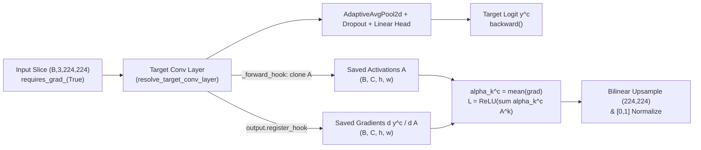

# Milestone 3: Clinical Evaluation, Calibration Reliability & Quantitative Grad-CAM

## 1. Overview: Why Accuracy Alone Fails Clinical MRI Deployment

In Milestones 1 and 2, we built a leak-free preprocessing pipeline and trained our two-stage diagnostic cascade:
- **Stage 1 (`compute_stage1_metrics`)**: Binary screening (`no_tumor` vs. `tumor`) calibrated via `find_sensitivity_threshold(..., target_sensitivity=0.98)`.
- **Stage 2 (`compute_stage2_metrics`)**: Three-class tumor subtyping (`glioma`, `meningioma`, `pituitary`) calibrated via `TemperatureScaler` and gated by confidence abstention (`uncertainty_threshold = 0.70`).
- **End-to-End Cascade (`compute_cascade_metrics`)**: Unified clinical routing across healthy predictions, confident subtypes, and specialist escalations (`ABSTAIN_LABEL`).

Milestone 3 completes the engineering loop in `mri_tumor.evaluation` and `mri_tumor.explain`: measuring **asymmetric clinical risk**, verifying **probability calibration** before abstaining, auditing **end-to-end 4x5 cascade routing**, and **quantitatively validating Grad-CAM heatmaps** against Figshare's ground-truth tumor segmentation masks (`tumorMask`) so we never mistake a "Clever Hans" shortcut for real pathology localization.

---

## 2. Sensitivity vs. Specificity Tradeoffs in Medical Screening vs. Subtyping

### 2.1 Stage 1 Screening: Why Sensitivity ($\ge 0.98$) and NPV Dominate Raw Accuracy

In binary brain MRI triage (`0 = no_tumor`, `1 = tumor`), the two error modes carry radically asymmetric clinical consequences:

| Outcome | Clinical Reality | Consequence |
| :--- | :--- | :--- |
| **False Negative ($FN$)** | True tumor slice classified as `no_tumor` | **Catastrophic**: Patient may be discharged with an undetected intracranial mass, delaying biopsy, neurosurgery, or radiotherapy. |
| **False Positive ($FP$)** | Healthy slice flagged as `tumor` | **Benign / Low-Cost**: Triggers Stage 2 subtyping, confidence inspection, or secondary neuroradiologist review. |

Accordingly, Stage 1 (`compute_stage1_metrics`) evaluates screening safety using:
$$\text{Sensitivity (Recall}^+\text{)} = \frac{TP}{TP + FN} \ge 0.98, \qquad \text{NPV} = \frac{TN}{TN + FN}, \qquad \text{Specificity} = \frac{TN}{TN + FP}$$

Why **Sensitivity** and **Negative Predictive Value (NPV)** matter far more than raw accuracy:
- Suppose a screening cohort is $90\%$ healthy and $10\%$ tumor. A trivial model predicting `no_tumor` for every scan achieves **$90\%$ accuracy**, yet has **Sensitivity = $0.00$**—missing $100\%$ of brain tumors.
- High **Sensitivity** ensures virtually every tumor-bearing scan advances past the Stage 1 gate.
- High **NPV** ensures that when Stage 1 clears a scan as `no_tumor`, the clinician can trust that negative clearance.
- Rather than using a naive $\tau = 0.50$ probability threshold, `find_sensitivity_threshold(probs_pos, targets, target_sensitivity=0.98)` selects the **highest** threshold $\tau^*$ that maximizes Specificity subject to $\text{Sensitivity}(\tau^*) \ge 0.98$. Lowering $\tau$ from $0.50$ to $\tau^*$ deliberately trades a modest drop in Specificity (more Stage 2/radiologist reviews) to eliminate catastrophic False Negatives.

### 2.2 AUROC vs. AUPRC Under Class Imbalance

`compute_stage1_metrics` reports both **AUROC** (`roc_auc_score`) and **AUPRC** (`average_precision_score`), because they behave very differently when `no_tumor` and `tumor` counts are skewed:

- **AUROC** plots **True Positive Rate** ($\frac{TP}{TP+FN}$) against **False Positive Rate** ($\frac{FP}{FP+TN}$). When negative scans vastly outnumber positive scans ($TN \gg FP$), even a large absolute number of False Positives barely nudges $\text{FPR} = \frac{FP}{FP + TN}$ upward. AUROC can therefore look reassuringly high ($>0.97$) even when positive predictions suffer from low precision.
- **AUPRC** plots **Precision** ($\frac{TP}{TP+FP}$) against **Recall** ($\frac{TP}{TP+FN}$). Because $TN$ does **not** appear anywhere in Precision or Recall, AUPRC directly exposes false-alarm overload among flagged scans—making it a sharper diagnostic for imbalanced screening cohorts.

*(Note: When a batch or split contains only a single ground-truth class, `compute_stage1_metrics` safely returns `None` for both `auroc` and `auprc` rather than crashing.)*

### 2.3 Stage 2 Subtyping: Why Macro-F1 & Balanced Accuracy Beat Overall Accuracy

In Stage 2 (`compute_stage2_metrics`), the model distinguishes among three tumor subtypes: `glioma`, `meningioma`, and `pituitary`. Public brain MRI cohorts such as Jun Cheng's Figshare dataset are naturally imbalanced across classes (e.g., glioma slices outnumber meningioma slices by nearly $2:1$).

If you optimize or report **overall accuracy** alone:
$$\text{Accuracy} = \frac{\sum_{c=1}^{K} TP_c}{N}$$
a classifier can score strongly by over-predicting the majority class (`glioma`) while quietly failing on minority subtypes (`meningioma`). `compute_stage2_metrics` therefore pairs overall accuracy and `weighted_f1` with two class-balanced metrics:

1. **Balanced Accuracy** (macro-averaged per-class recall over present classes):
   $$\text{Balanced Accuracy} = \frac{1}{K} \sum_{c=1}^{K} \text{Recall}_c = \frac{1}{K} \sum_{c=1}^{K} \frac{TP_c}{TP_c + FN_c}$$
2. **Macro-F1** (unweighted arithmetic mean of per-class $F_1$ scores):
   $$\text{Macro-F1} = \frac{1}{K} \sum_{c=1}^{K} \frac{2 \cdot \text{Precision}_c \cdot \text{Recall}_c}{\text{Precision}_c + \text{Recall}_c}$$

Every subtype contributes equally ($\frac{1}{3}$ weight) to Balanced Accuracy and Macro-F1 regardless of slice count, immediately exposing majority-class dominance.

---

## 3. Reliability, Calibration (`ECE` & `Brier Score`), and Confidence Abstention

### 3.1 Why Calibration Must Be Validated Before Abstaining

In Milestone 2, Stage 2 applies confidence abstention at `uncertainty_threshold = 0.70` via `apply_temperature_and_abstention`: any tumor scan with $\max_c \hat{p}_c < 0.70$ is escalated to `ABSTAIN_LABEL` (`"Tumor detected — subtype uncertain (refer to specialist)"`).

However, a confidence threshold of $0.70$ is clinically meaningless if the network's probabilities are **uncalibrated**:
- Modern neural networks trained with cross-entropy routinely exhibit **overconfidence**, emitting $\max_c p_c = 0.95$ even when empirical accuracy on those predictions is only $72\%$.
- If raw overconfident probabilities are fed directly into a $0.70$ abstention gate, genuinely ambiguous slices sail past the gate unchecked.

We quantify probability reliability using two complementary metrics in `mri_tumor.evaluation.metrics`:

#### Expected Calibration Error (`compute_ece` & `compute_calibration_bins`)
Predictions are partitioned into $M = 10$ equal-width confidence bins $B_1, \dots, B_M$ covering $[0, 1]$ (with bin 0 inclusive of $0.0$ and bins $1 \dots M-1$ half-open $(b_{\text{low}}, b_{\text{high}}]$). For each non-empty bin $B_m$:
- $\text{acc}(B_m) = \frac{1}{|B_m|} \sum_{i \in B_m} \mathbb{I}(\hat{y}_i = y_i)$ is the empirical accuracy in bin $m$.
- $\text{conf}(B_m) = \frac{1}{|B_m|} \sum_{i \in B_m} \max_c p_{i,c}$ is the mean predicted confidence in bin $m$.

`compute_ece` computes the sample-weighted $L_1$ gap between confidence and empirical accuracy:
$$\text{ECE} = \sum_{m=1}^{M} \frac{|B_m|}{N} \left|\text{acc}(B_m) - \text{conf}(B_m)\right|$$

Visualized via `plot_calibration_curve`, a perfectly calibrated model aligns along the diagonal $y = x$ ($\text{ECE} = 0$). Curves sagging **below** the diagonal indicate **overconfidence** ($\text{conf} > \text{acc}$); curves rising **above** indicate **underconfidence**.

#### Multi-Class Brier Score (`compute_stage2_metrics`)
Unlike ECE—which depends on binning and evaluates only the top-1 predicted class—the multi-class **Brier Score** is a strictly proper scoring rule evaluated over the full probability vector $p_i \in \Delta^{K-1}$ and one-hot ground-truth vector $y_i \in \{0, 1\}^K$:
$$\text{Brier Score} = \frac{1}{N} \sum_{i=1}^{N} \sum_{c=1}^{K} \left(p_{i,c} - y_{i,c}\right)^2$$

Lower Brier Score indicates both sharper discrimination and better-calibrated probability vectors across all $K$ classes. Fitting `TemperatureScaler` on validation logits shrinks both **ECE** and **Brier Score** without altering `argmax` predictions, ensuring that when `uncertainty_threshold = 0.70` is applied, abstention accurately separates high-reliability predictions (`selective_accuracy`, `selective_macro_f1`) from ambiguous cases (`abstention_rate`).

---

## 4. End-to-End 4-Way Cascade Evaluation (`4x4` vs. `4x5` Clinical Routing Matrix)

Evaluating Stage 1 and Stage 2 in isolation hides how errors compound across the pipeline. `compute_cascade_metrics` evaluates the complete 4-class clinical system over `DEFAULT_CASCADE_CLASSES = ("no_tumor", "glioma", "meningioma", "pituitary")`.

### 4.1 Why `4x5` Instead of `4x4`?

A standard multi-class confusion matrix is $4 \times 4$, which forces every scan into one of four definitive labels. Because Stage 2 can abstain when calibrated confidence falls below `0.70`, our cascade actually has **5 possible routing destinations**:
$$\text{Columns} = [\,\text{"no\_tumor"},\; \text{"glioma"},\; \text{"meningioma"},\; \text{"pituitary"},\; \text{"uncertain"}\,]$$

`compute_cascade_metrics` therefore constructs both:
- `confusion_matrix_4way` ($4 \times 4$): Exact subtype/healthy classification on resolved predictions (or raw un-abstained predictions if `raw_4way_preds` is supplied).
- `routing_matrix_4x5` ($4 \times 5$): Full clinical disposition matrix showing exactly how each ground-truth cohort routes across definitive diagnoses and `"uncertain"` specialist referrals (`ABSTAIN_LABEL`).

*(Note: `plot_confusion_matrix` natively accepts non-square matrices like `4x5` by matching row labels to `class_names[:cm.shape[0]]` and column labels to all 5 `routing_columns`.)*

### 4.2 `cascade_tumor_sensitivity` & `cascade_healthy_specificity`

Look closely at how clinical safety is defined in `compute_cascade_metrics`:
- **True tumor samples** (`true_idx != 0`, i.e., glioma, meningioma, or pituitary):
  $$\text{cascade\_tumor\_sensitivity} = \frac{1}{|\{i : y_i \ne 0\}|} \sum_{i : y_i \ne 0} \mathbb{I}(\text{routed}_i \ne 0)$$
  Any true tumor routed to a tumor subtype (`1, 2, 3`) **or** routed to `"uncertain"` (`4`, `"Tumor detected — subtype uncertain (refer to specialist)"`) counts as **detected**! Only a tumor misrouted to `"no_tumor"` (`0`) counts as a clinical miss.
- **True healthy samples** (`true_idx == 0`, `no_tumor`):
  $$\text{cascade\_healthy\_specificity} = \frac{1}{|\{i : y_i = 0\}|} \sum_{i : y_i = 0} \mathbb{I}(\text{routed}_i = 0)$$
  Measures how cleanly healthy scans are cleared without unnecessary Stage 2/specialist workups.

### 4.3 `overall_4way_*` vs. `selective_4way_*`

`compute_cascade_metrics` distinguishes full-cohort performance from resolved-only performance:

| Metric Pair | Evaluated Samples | Behavior with Abstention |
| :--- | :--- | :--- |
| **`selective_4way_accuracy`**, **`selective_4way_macro_f1`** | Strictly **resolved** (`routed_idx != "uncertain"`) samples | Measures accuracy/Macro-F1 on scans where the cascade issues a confident definitive label (returns `None` if 100% abstained). |
| **`overall_4way_accuracy`**, **`overall_4way_macro_f1`** (when `raw_4way_preds=None`) | **All $N$** samples | Treats `"uncertain"` predictions as unresolved/incorrect for exact 4-way classification—penalizing excessive abstention. |
| **`overall_4way_accuracy`**, **`overall_4way_macro_f1`** (when `raw_4way_preds` provided) | **All $N$** samples using un-abstained predictions | Reports the baseline 4-way classification quality before confidence abstention is applied. |

Together with `abstention_rate`, these metrics reveal the exact clinical tradeoff: does abstaining on the hardest $10\%\text{–}15\%$ of tumors push `selective_4way_accuracy` and `selective_4way_macro_f1` into reliable territory while keeping `cascade_tumor_sensitivity` high?

---

## 5. Grad-CAM Mathematics & Safe Activation Hooks

Even high-accuracy CNNs can achieve strong test metrics for the wrong reasons. Before trusting a classifier in neuroradiology, we inspect **where** in the slice the network draws its evidence using **Gradient-weighted Class Activation Mapping (Grad-CAM)** (`mri_tumor.explain.GradCAM`).

### 5.1 Step-by-Step Mathematical Derivation

Let $A \in \mathbb{R}^{C \times h \times w}$ denote the spatial activation tensor produced by the model's final convolutional layer or block (resolved automatically via `resolve_target_conv_layer`: e.g., the final `Conv2d` `(256, 14, 14)` for `SimpleCNN`, `conv_head` `(1280, 7, 7)` for `efficientnet_b0`, `layer4[-1]` `Bottleneck` `(2048, 7, 7)` for `resnet50`, or `stages[-1]` / `blocks[-1]` / `features[-1]` for ConvNeXt / MobileNet / DenseNet-VGG backbones at input resolution $224 \times 224$), and let $y^c$ be the pre-softmax logit for target class $c$.

1. **Target Logit Spatial Gradients**:
   Differentiate the class-$c$ logit $y^c$ with respect to every channel $k \in \{1, \dots, C\}$ and spatial location $(i, j) \in \{1, \dots, h\} \times \{1, \dots, w\}$ of feature map $A$:
   $$g^k_{ij} = \frac{\partial y^c}{\partial A^k_{ij}}$$

2. **Channel Importance Weights via Global Average Pooling**:
   Average spatial gradients across the $h \times w$ feature grid to obtain a scalar importance weight $\alpha_k^c$ for feature map channel $A^k$:
   $$\alpha_k^c = \frac{1}{hw} \sum_{i=1}^{h} \sum_{j=1}^{w} \frac{\partial y^c}{\partial A^k_{ij}}$$
   Intuitively, $\alpha_k^c$ represents the linearized sensitivity of class-$c$ evidence to increasing activation in convolutional filter $k$.

3. **Weighted Linear Combination + $\text{ReLU}$**:
   Combine forward activation maps weighted by $\alpha_k^c$ and apply $\text{ReLU}$ to retain **only** spatial regions whose features positively increase logit $y^c$ (discarding negative regions associated with competing classes):
   $$L_{\text{Grad-CAM}}^c = \text{ReLU}\!\left(\sum_{k=1}^{C} \alpha_k^c A^k\right) \in \mathbb{R}_{\ge 0}^{h \times w}$$

4. **Bilinear Upsampling & $[0, 1]$ Normalization**:
   Upsample $L_{\text{Grad-CAM}}^c$ from $(h, w)$ to input image resolution $(224, 224)$ using bilinear interpolation (`F.interpolate(..., size=(height, width), mode="bilinear", align_corners=False)`), then normalize to $[0, 1]$:
   $$\hat{L}^c(r, c') = \begin{cases} \dfrac{L_{\text{up}}^c(r, c')}{\max_{(u,v)} L_{\text{up}}^c(u,v)} & \text{if } \max_{(u,v)} L_{\text{up}}^c(u,v) > 10^{-12} \\ 0 & \text{otherwise} \end{cases}$$

### 5.2 Avoiding `inplace=True` Backward Hook Failures

A classic PyTorch pitfall in Grad-CAM implementations is attaching `register_full_backward_hook` to a module whose output is immediately mutated by an `inplace=True` `ReLU` or `SiLU`: PyTorch raises a `RuntimeError` during backprop because the saved tensor version counter changed in-place.

`mri_tumor.explain.GradCAM` avoids this cleanly in two layers:
1. **Model-level safety (`disable_inplace_activations`)**: `TimmClassifier` calls `disable_inplace_activations(self.backbone)` upon initialization, and `SimpleCNN` explicitly constructs every block with `nn.ReLU(inplace=False)`.
2. **Activation tensor hooks (`output.register_hook`)**: Inside `_forward_hook`, `GradCAM` clones `output.detach()` for `_activations` and attaches a tensor-level gradient hook directly to `output` (`output.register_hook(self._save_grad)`) rather than relying on fragile module-level backward hooks—and cleans up per-pass handles in `_clear_step_state()` inside a `finally` block.

---

## 6. Why Qualitative Heatmaps Are Not Enough: Clever Hans Detection

### 6.1 The "Clever Hans" Failure Mode in Medical Imaging

Visualizing three cherry-picked Grad-CAM overlays (`overlay_gradcam`, `plot_gradcam_examples`) can fool researchers into thinking a model understands tumor pathology. In reality, MRI classifiers frequently act as **Clever Hans** predictors—achieving high test accuracy by latching onto spurious shortcuts:
- **Skull contours or scalp fat** correlating with slice orientation or patient identity.
- **Scanner burn-in annotations** (`L`/`R` markers, hospital watermarks, bounding-box borders).
- **Empty background corners** carrying acquisition-specific noise floors across pooled datasets.

### 6.2 Quantitative Validation Against Figshare `tumorMask`

Jun Cheng's Figshare dataset provides pixel-level binary tumor segmentation masks ($M_{\text{tumor}} \in \{0, 1\}^{224 \times 224}$) for every tumor slice. `mri_tumor.explain.gradcam` leverages these ground-truth masks to audit every model quantitatively via two complementary metrics:

#### 1. Pointing-Game Hit Rate (`compute_pointing_game_hit`)
Tests whether the single strongest Grad-CAM peak lies inside the ground-truth tumor mask:
$$\text{PointingHit}(\hat{L}, M_{\text{tumor}}) = \mathbb{I}\!\left[\arg\max_{(r,c)} \hat{L}(r, c) \in M_{\text{tumor}}\right]$$
*(An optional `tolerance_px > 0` dilates $M_{\text{tumor}}$ with an elliptical kernel of radius `tolerance_px` to allow boundary margin checks, while `tolerance_px = 0` enforces strict pixel containment.)*

#### 2. Energy-Inside-Mask Ratio (`compute_energy_inside_mask`)
Even if the single peak pixel lands inside the tumor, a Clever Hans model might still scatter $80\%$ of its heatmap energy across the skull rim or background. `compute_energy_inside_mask` measures the total proportion of positive Grad-CAM attribution mass concentrated inside $M_{\text{tumor}}$:
$$\text{EnergyInMask}(\hat{L}, M_{\text{tumor}}) = \frac{\sum_{(r,c) \in M_{\text{tumor}}} \max(\hat{L}(r,c), 0)}{\sum_{\text{all }(r,c)} \max(\hat{L}(r,c), 0)} \in [0, 1]$$

Running `evaluate_gradcam_against_masks(gradcam, loader, target_mode="predicted")` over a masked `DataLoader` aggregates `pointing_game_hit_rate`, `mean_energy_in_mask`, `median_energy_in_mask`, and `std_energy_in_mask` across all tumor-masked slices—allowing direct quantitative comparison across CNN backbones (e.g., `SimpleCNN` vs. `TimmClassifier("efficientnet_b0")` vs. `TimmClassifier("resnet50")`) via `plot_ablation_comparison` and unified reporting via `generate_evaluation_report`.

---

## 7. Summary Checklist for Milestone 3

- [x] **Asymmetric Clinical Metrics**: `compute_stage1_metrics` tracks Sensitivity ($\ge 0.98$), NPV, Specificity, AUROC, and AUPRC; `compute_stage2_metrics` tracks Balanced Accuracy and Macro-F1 alongside per-class breakdown.
- [x] **Calibration Reliability**: `compute_calibration_bins`, `compute_ece` ($M=10$), and multi-class `brier_score` verify `TemperatureScaler` before applying `uncertainty_threshold = 0.70`.
- [x] **4x5 Cascade Disposition**: `compute_cascade_metrics` tracks the $4 \times 5$ routing matrix, counts abstained true tumors as detected in `cascade_tumor_sensitivity`, and separates `overall_4way_*` from `selective_4way_*`.
- [x] **Quantitative Grad-CAM**: `GradCAM` safely captures gradients via tensor hooks (`inplace=False`), upsamples to $(224, 224)$, and quantifies localization fidelity with `compute_pointing_game_hit`, `compute_energy_inside_mask`, and `evaluate_gradcam_against_masks`.
- [x] **Automated Reporting**: `plot_confusion_matrix`, `plot_roc_curves`, `plot_calibration_curve`, `plot_ablation_comparison`, `plot_gradcam_examples`, and `generate_evaluation_report` emit `evaluation_report.md`, `metrics_summary.json`, and publication-ready PNG figures.
