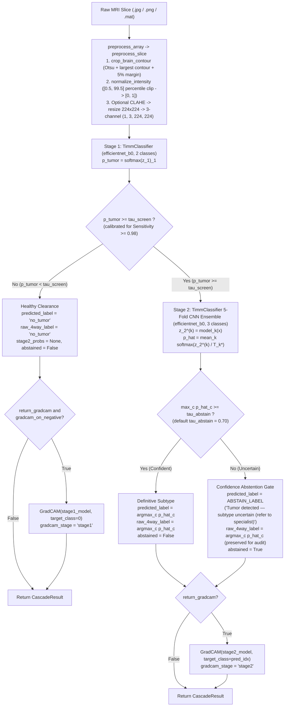

# Milestone 4: Two-Stage Cascade Inference, Calibration Persistence & Laptop-Optimized Deployment

## 1. Overview: From Isolated Models to a Safe Clinical System

Across Milestones 1–3, we established leak-free splits and standardized preprocessing (`mri_tumor.data`), trained and calibrated our Stage 1 binary screener and Stage 2 subtype classifier (`mri_tumor.models`, `mri_tumor.training`), and built the clinical evaluation and quantitative Grad-CAM suite (`mri_tumor.evaluation`, `mri_tumor.explain`).

Milestone 4 unifies those pieces into a production-ready diagnostic pipeline (`mri_tumor.inference`, `mri_tumor.app.cli`):
1. **Cascaded Decision Routing (`CascadePredictor`)**: Runs Stage 1 screening first, invokes Stage 2 subtyping and Grad-CAM only when Stage 1 fires positive, and escalates low-confidence predictions to a specialist via the Confidence Abstention Gate.
2. **Automatic Calibration Persistence (`calibration.json`)**: `mri-tumor train` persists calibrated Stage 1 thresholds and Stage 2 temperatures directly beside `best_model.pt`, and `CascadePredictor.from_configs()` automatically overrides `cascade.yaml` defaults at inference time.
3. **Laptop-Optimized CLI & Pre-Cropped PNG Caching (`mri-tumor`)**: Five subcommands (`prepare`, `train`, `evaluate`, `predict`, `ui`) paired with `cache_preprocessed_manifest` and Windows-safe `resolve_dataloader_kwargs` keep training and inference responsive on 6 GB VRAM laptops (e.g., RTX 3050).

---

## 2. Cascaded Decision Routing (`Stage 1 -> Stage 2 -> Abstention`)

### 2.1 End-to-End Decision Flow inside `CascadePredictor`

When `CascadePredictor.predict_image(image)` or `CascadePredictor.predict_file(filepath)` is called, the slice passes through `CascadePredictor.preprocess_array` and then enters `CascadePredictor.predict_tensor`:



### 2.2 Step-by-Step Trace of `CascadePredictor.predict_tensor`

1. **Standardized Preprocessing (`preprocess_array` $\rightarrow$ `preprocess_slice`)**:
   - Alpha channels on RGBA inputs (`arr.shape[2] == 4`) are stripped to RGB (`arr[:, :, :3]`).
   - `crop_brain_contour` applies a $5\times 5$ Gaussian blur, Otsu thresholding, morphological open/close cleanup, and extracts the largest external contour expanded by `crop_margin_ratio` (`0.05` = 5%) to discard empty scanner borders.
   - `normalize_intensity` clips intensities to the `[0.5, 99.5]` percentile window and rescales to `[0.0, 1.0]` `float32`.
   - The cropped slice is resized (`INTER_LINEAR`) to `224x224`, expanded to 3 identical channels `(224, 224, 3)`, and packed into a contiguous `(1, 3, 224, 224)` PyTorch tensor alongside a `uint8` RGB copy (`uint8_rgb`) for crisp Grad-CAM overlays.

2. **Stage 1 Binary Screening (`TimmClassifier`, `num_classes=2`)**:
   - Evaluates logits $z_1 = f_{\text{stage1}}(x) \in \mathbb{R}^{1 \times 2}$ in `eval()` mode with `torch.no_grad()` and computes:
     $$p_{\text{tumor}} = \operatorname{softmax}(z_1)_1 = \frac{e^{z_{1,1}}}{e^{z_{1,0}} + e^{z_{1,1}}}$$
   - **Immediate Negative Exit**: If $p_{\text{tumor}} < \tau_{\text{screen}}$ (`self.stage1_threshold`, calibrated via `find_sensitivity_threshold(..., target_sensitivity=0.98)`), Stage 2 is **never executed**. `_build_negative_result` returns `CascadeResult` with `stage1_positive=False`, `predicted_label="no_tumor"`, `raw_4way_label="no_tumor"`, `abstained=False`, `stage2_probs=None`, and `stage2_confidence=None`.
   - *(By default, Grad-CAM is skipped on healthy clearances unless `gradcam_on_negative=True`, in which case `GradCAM(self.stage1_model)` targets class `0`.)*

3. **Selective Stage 2 Subtyping (`TimmClassifier` CNN / 5-Fold Ensemble, `num_classes=3`)**:
   - Runs **only** when $p_{\text{tumor}} \ge \tau_{\text{screen}}$ (`stage1_positive=True`).
   - Evaluates either a single `stage2_checkpoint` or the `stage2_checkpoints` 5-fold CV ensemble (`configs/cascade.yaml`) over `("glioma", "meningioma", "pituitary")` via `predict_stage2_probs_tensor`:
     $$\hat{p} = \frac{1}{M} \sum_{k=1}^{M} \operatorname{softmax}\!\left(\frac{z_2^{(k)}}{T_k^*}\right)$$
     where each fold model $k$ uses its own validation-fitted positive scalar temperature $T_k^*$ (`self.stage2_temperatures`, learned via `TemperatureScaler.fit`), followed by confidence gating in `_apply_abstention_to_probs`. (When `return_gradcam=True`, `GradCAM` targets `self.stage2_model`, the primary/first Stage 2 CNN.)

4. **Confidence Abstention Gate & Audit Preservation (`CascadeResult`)**:
   - Let $c^* = \arg\max_c \hat{p}_c$ and $\text{confidence} = \max_c \hat{p}_c$.
   - If $\text{confidence} < \tau_{\text{abstain}}$ (`self.stage2_uncertainty_threshold`, default `0.70`), the gate sets `abstained = True` and assigns:
     $$\text{predicted\_label} = \texttt{ABSTAIN\_LABEL} = \text{"Tumor detected — subtype uncertain (refer to specialist)"}$$
   - **Audit Trail (`raw_4way_label`)**: Even when the cascade abstains, `_build_positive_result` preserves `raw_4way_label = self.stage2_classes[pred_idx]` (e.g., `"glioma"`). This enables `compute_cascade_metrics(..., raw_4way_preds=...)` to measure both **selective** 4-way accuracy (on confident diagnoses) and **un-abstained** 4-way accuracy across the full cohort, alongside the $4 \times 5$ clinical routing matrix.
   - **Batched Inference (`predict_batch_tensors`)**: During evaluation over a `DataLoader`, Stage 1 runs across the entire batch `(B, 3, H, W)` in one forward pass, gathers `pos_indices` where `tumor_prob >= stage1_threshold`, and runs Stage 2 solely on `batch[pos_indices]`.

| `CascadeResult` Field | Negative Clearance (`p_tumor < tau_screen`) | Confident Tumor (`conf >= tau_abstain`) | Abstained Tumor (`conf < tau_abstain`) |
| :--- | :--- | :--- | :--- |
| `stage1_positive` | `False` | `True` | `True` |
| `predicted_label` | `"no_tumor"` | `stage2_classes[pred_idx]` | `ABSTAIN_LABEL` |
| `raw_4way_label` | `"no_tumor"` | `stage2_classes[pred_idx]` | `stage2_classes[pred_idx]` |
| `abstained` | `False` | `False` | `True` |
| `stage2_probs` | `None` | `{"glioma": ..., "meningioma": ..., "pituitary": ...}` | `{"glioma": ..., "meningioma": ..., "pituitary": ...}` |
| `stage2_confidence` | `None` | $\max_c \hat{p}_c \ge 0.70$ | $\max_c \hat{p}_c < 0.70$ |
| `gradcam_stage` (if requested) | `None` (or `"stage1"` if `gradcam_on_negative=True`) | `"stage2"` | `"stage2"` |

---

## 3. Automatic Calibration Persistence (`calibration.json` & `CascadePredictor.from_configs`)

### 3.1 How `mri-tumor train` Persists Calibration Parameters

Hardcoding calibrated thresholds inside YAML files is error-prone: every time you retrain Stage 1 or switch CV folds in Stage 2, the optimal sensitivity cutoff $\tau_{\text{screen}}$ and temperature $T^*$ change.

Immediately after `Trainer.fit(train_loader, val_loader)` restores the lowest-validation-loss checkpoint (`checkpoints/stage*/best_model.pt`), `train_command` runs `trainer.predict_logits(val_loader)` on the validation split and writes `calibration.json` into the **same checkpoint directory**:

- **Stage 1 (`checkpoints/stage1/calibration.json`)**:
  Computes `probs_pos = softmax(val_logits)[:, 1]` and calls `find_sensitivity_threshold(probs_pos, val_targets, target_sensitivity=0.98)`:
  ```json
  {
    "stage": "stage1",
    "threshold": 0.2741,
    "sensitivity": 0.9833,
    "specificity": 0.9125,
    "precision": 0.8939,
    "target_sensitivity": 0.98,
    "achieved_target": true
  }
  ```
- **Stage 2 (`checkpoints/stage2/calibration.json`)**:
  Fits `TemperatureScaler().fit(val_logits, val_targets)` via L-BFGS to minimize validation NLL and pairs it with the configured `uncertainty_threshold`:
  ```json
  {
    "stage": "stage2",
    "temperature": 1.642,
    "uncertainty_threshold": 0.70,
    "fold": 0
  }
  ```

### 3.2 How `CascadePredictor.from_configs()` Resolves Paths & Overrides Defaults

`CascadePredictor.from_configs(cascade_config_path, device=None, load_weights=True, allow_missing_checkpoints=False)` provides zero-manual-copy deployment:

1. **Project-Root Relative Path Resolution (`resolve_config_path`)**:
   - When `cascade_config_path` resides in a `configs/` or `config/` folder (e.g., `configs/cascade.yaml`), `resolve_config_path` treats `cascade_path.resolve().parent.parent` as the project root (`base_dir`).
   - Relative paths inside `cascade.yaml` (such as `"configs/stage1.yaml"`, `"checkpoints/stage1/best_model.pt"`, and `"checkpoints/stage2/best_model.pt"`) are searched across `[base_dir, cfg_dir, proj_root]` (with CWD fallback disabled if `cascade_root` has its own `configs/` directory, preventing accidental cross-project weight loading during tests or multi-experiment runs).
2. **Offline-Safe Checkpoint Loading**:
   - When `load_weights=True` and checkpoint files exist, `from_configs` deep-copies `s1_cfg` and `s2_cfg` and sets `model["pretrained"] = False` before calling `build_model_from_config(...)`, then loads weights via `load_checkpoint(...)`. This prevents `timm` from attempting unnecessary ImageNet weight downloads when deploying offline with local checkpoints.
3. **Automatic `calibration.json` Override Precedence**:
   - First reads fallback defaults from `configs/cascade.yaml`: `stage1_threshold` (`0.35`), `stage2_temperature` (`1.0`), `stage2_uncertainty_threshold` (`0.70`).
   - Next checks `s1_ckpt.parent / "calibration.json"` and `s2_ckpt.parent / "calibration.json"` via `_read_json_if_exists`:
     - If `s1_cal.get("threshold")` is present, it **overrides** `stage1_threshold`.
     - If `s2_cal.get("temperature")` is present, it **overrides** `stage2_temperature`.
     - If `s2_cal.get("uncertainty_threshold")` is present, it **overrides** `stage2_uncertainty_threshold`.

As a result, `configs/cascade.yaml` stays clean and static while `mri-tumor evaluate`, `mri-tumor predict`, and `mri-tumor ui` automatically pick up the latest calibrated operating point after any training run.

---

## 4. Laptop-Optimized CLI & Pre-Cropped Cache Workflow (`mri-tumor`)

The `mri-tumor` console entry point (`mri_tumor.app.cli:main`, registered in `pyproject.toml`) exposes five subcommands designed to run end-to-end on Windows/Linux laptops with 6 GB VRAM (such as an NVIDIA RTX 3050).

### 4.1 The 5 CLI Commands

| Command | Purpose | Key Flags & Behavior |
| :--- | :--- | :--- |
| **`mri-tumor prepare`** | Extracts raw archives (if needed), runs patient-grouped Stage 2 splits + pHash cross-dataset deduplication for Stage 1, creates `cascade_test_manifest.csv`, and optionally builds the PNG cache. | `--config configs/cascade.yaml`<br/>`--figshare-zip`, `--nickparvar-zip`<br/>`--cache` / `--no-cache` (overrides `use_cache` in stage YAMLs)<br/>`--max-hamming 6` |
| **`mri-tumor train`** | Trains Stage 1 or Stage 2 with `Trainer` (AMP on CUDA, two-phase freeze/unfreeze, early stopping) and writes `best_model.pt` + `calibration.json`. | `--config configs/stage1.yaml` (or `stage2.yaml`)<br/>`--fold 0`, `--arch`, `--backbone`, `--epochs`, `--batch-size`, `--num-workers`, `--lr`<br/>`--no-pretrained`, `--no-cache`<br/>`--resume` (loads `best_model.pt` before training)<br/>`--skip-if-exists` (no-op if both `best_model.pt` & `calibration.json` exist) |
| **`mri-tumor evaluate`** | Runs `CascadePredictor.from_configs`, computes Stage 1, Stage 2, Cascade `4x5`, and Grad-CAM mask-overlap metrics, and writes `evaluation_report.md`, `metrics_summary.json`, and PNG plots. | `--config configs/cascade.yaml`<br/>`--output-dir outputs/evaluation`<br/>`--gradcam-samples 24`<br/>`--batch-size 32`, `--num-workers 0` |
| **`mri-tumor predict`** | Runs single-slice cascade inference on `.jpg`, `.png`, or `.mat` input, optionally exporting a Grad-CAM overlay PNG or structured JSON. | `--config configs/cascade.yaml`<br/>`--image path/to/slice.mat`<br/>`--gradcam-out overlay.png` (triggers `return_gradcam=True` & `gradcam_on_negative=True`)<br/>`--json` |
| **`mri-tumor ui`** | Launches the interactive Gradio clinical dashboard (`mri_tumor.app.web_ui:launch_ui`). | `--config configs/cascade.yaml`<br/>`--host 127.0.0.1`, `--port 7860`, `--share` |

### 4.2 Example End-to-End CLI Session

```bash
# 1. Extract archives, deduplicate across datasets, build splits, and pre-crop PNG cache
mri-tumor prepare --config configs/cascade.yaml --cache

# 2. Train Stage 1 screener + calibrate sensitivity >= 0.98 threshold
mri-tumor train --config configs/stage1.yaml --skip-if-exists

# 3. Train Stage 2 CNN subtyper (fold 0, or folds 0..4 for 5-fold ensemble) + calibrate temperature T*
mri-tumor train --config configs/stage2.yaml --fold 0 --skip-if-exists

# 4. Evaluate Stage 1, Stage 2, 4x5 cascade routing, and Grad-CAM mask overlap
mri-tumor evaluate --config configs/cascade.yaml --gradcam-samples 24

# 5. Predict a single slice and save its Grad-CAM overlay
mri-tumor predict --config configs/cascade.yaml --image sample.mat --gradcam-out outputs/gradcam.png --json

# 6. Launch the interactive Gradio clinical web interface
mri-tumor ui --config configs/cascade.yaml --port 7860
```

### 4.3 Why Pre-Cropped Caching & `resolve_dataloader_kwargs` Matter on RTX 3050 6 GB Laptops

Without caching, every epoch of training and every evaluation pass inside `SliceDataset.__getitem__` performs heavy CPU work **per image**:
1. Opening HDF5 `.mat` containers (`read_figshare_mat` via `h5py`, transposing `(W, H)` arrays).
2. Running `crop_brain_contour` (float conversion $\rightarrow$ $5\times 5$ Gaussian blur $\rightarrow$ Otsu thresholding $\rightarrow$ morphological opening & closing $\rightarrow$ contour extraction $\rightarrow$ bounding box crop).
3. Computing `np.percentile(..., [0.5, 99.5])` intensity normalization and resizing to `224x224`.

On a laptop CPU feeding an RTX 3050 (6 GB VRAM), this per-sample OpenCV + HDF5 pipeline starves the GPU—leaving CUDA utilization spiky while Python data workers saturate CPU cores and system RAM.

`mri-tumor prepare --cache` eliminates this bottleneck cleanly:
- `cache_preprocessed_manifest` executes `preprocess_slice` **once** per slice (idempotently skipping already-cached PNGs when `overwrite=False`), saving compact `224x224` `uint8` PNGs under `data/cache/stage*/images/` (and binary masks under `masks/`) and recording `cached_path` and `cached_mask_path` columns in the manifest CSVs.
- `_propagate_cache_columns` copies those `cached_path` / `cached_mask_path` entries into `data/manifests/cascade_test_manifest.csv` so `mri-tumor evaluate` also benefits.
- During `SliceDataset.__getitem__`, when `cached_path` resolves to an existing PNG (and `--no-cache` was not passed), the loader jumps directly to `load_rgb_image(cached_img_path)` and scales by `1 / 255.0`, bypassing HDF5 parsing, Otsu thresholding, morphological ops, and percentile estimation completely.
- Combined with `resolve_dataloader_kwargs` (`src/mri_tumor/data/datasets.py`)—which on Windows (`os.name == "nt"`) caps CLI script workers at `min(num_workers, 2)` and forces `num_workers=0` inside Jupyter notebooks to prevent Windows multiprocessing `spawn` hangs and duplicate RAM explosions—together with AMP (`use_amp=True`) and `gc.collect()` / `torch.cuda.empty_cache()` between stages in `train_command`, the full cascade fits comfortably within 6 GB VRAM and modest laptop memory.
